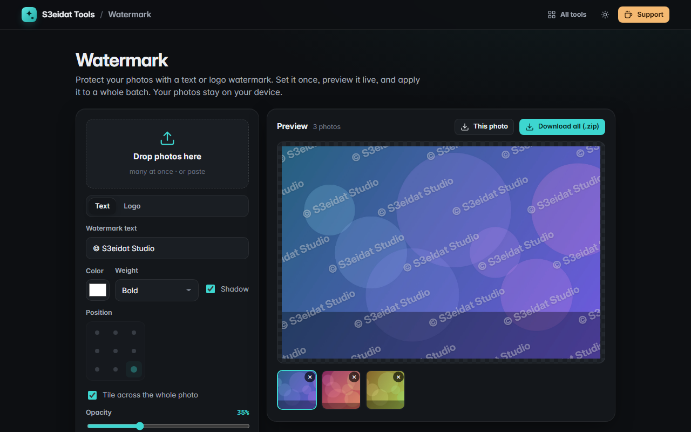

# Watermark

> Add text or logo watermarks to many photos at once. Free, private, and it runs entirely in your browser.

### ▶ [Open Watermark](https://s3eidat.github.io/watermark/)



## Features

- **Text** watermark (any text, color, weight, optional soft shadow) or **logo** watermark (PNG with transparency, JPG, SVG…)
- **9 positions** or **tiled** across the whole photo in a brick pattern
- **Opacity, size, rotation, margin** (or tile spacing), all relative to each photo's size, so a batch of
  different sizes and orientations looks consistent
- **Live preview** on any photo in the batch
- Full-resolution export as the original format, JPG, PNG or WebP
- Download one photo or **everything as a .zip**

Note: photos are re-encoded through your browser's canvas, so metadata (EXIF, GPS) is not carried over.

## Privacy


Your photos never leave your device. There is no server, no account, no analytics.
The page ships with a strict Content-Security-Policy (`connect-src 'self'`), so the browser
itself blocks any attempt to send data anywhere.

## Run it yourself

It's plain HTML, CSS and JavaScript with no build step:

```bash
git clone https://github.com/s3eidat/watermark
cd watermark
python -m http.server 8000
```

Then open http://localhost:8000.

## Support

If this saved you time, **[buy me a coffee ☕](https://s3eidat.github.io/coffee/)**. It keeps every tool free.

---

Part of **[S3eidat Tools](https://s3eidat.github.io/)**: 100+ free, private tools that run in your browser. MIT licensed.
